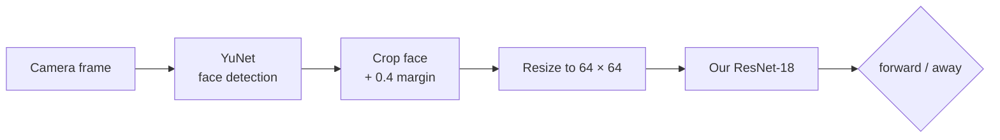
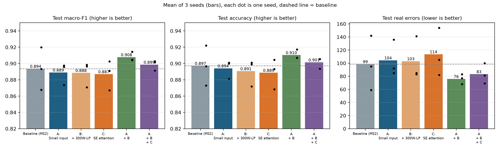

<div align="center">

# LookAway Guard

**Screen privacy through head orientation**

A laptop camera watches the person at the screen. When they look at the screen, it stays visible. When they look away, it would be blurred so nobody else can read it.


*DMET 901 Computer Vision · German University in Cairo (GUC)*

</div>

---

## Overview

The core is a **ResNet-18** that classifies a 64 × 64 face crop as one of two classes:

| Class | Rule |
|---|---|
| **forward** | \|yaw\| ≤ 20° **and** \|pitch\| ≤ 20° |
| **away** | anything else |

It is trained on the **BIWI Kinect Head Pose** dataset with a **person-level split**: 12 people for training, 4 for validation and 4 for testing. The test people never appear in training, so the scores show how well the model works on new faces.



## Results

Test set, mean ± std over 3 seeds:

| Model | Macro-F1 | Accuracy | Real errors\* |
|---|---|---|---|
| Milestone 2 baseline | 0.894 ± 0.021 | 89.7% | 99 ± 34 |
| **Milestone 3: small-input ResNet-18 + 300W-LP training data** | **0.908 ± 0.005** | **91.0%** | **76 ± 6** |

\* Errors on heads that are clearly forward (< 17.5°) or clearly away (> 22.5°). Errors between 17.5° and 22.5°, right at the 20° line, are counted separately as "accepted".

<p align="center">
  
</p>

### Milestone 3 improvements

Every experiment changes the model or the data. Hyperparameters, the loss and the metrics stay fixed.

| Experiment | What changes | Kept? |
|---|---|---|
| **A: Small input** | First conv uses stride 1 and the max-pool is removed, so the network reads the 64 × 64 crop directly instead of a 224 × 224 upscale | ✅ |
| **B: + 300W-LP** | Adds the 300W-LP face crops (thousands of people) to training. Validation and test stay on the same BIWI people | ✅ |
| **C: SE attention** | Adds a squeeze-and-excitation block to each residual block | ❌ no gain |
| **A + B** | Both kept changes together: **final model** | ✅ |
| A + B + C | All three | ❌ |

## Repository layout

```
.
├── MS1/                          Milestone 1: problem and dataset
│   ├── ms1_biwi_dataset_check.ipynb
│   ├── ms1_report.pdf
│   └── ms1_slides.pptx
├── MS2/                          Milestone 2: baseline model
│   ├── ms2_resnet18_biwi.ipynb   training + evaluation notebook
│   ├── ms2_results.json          saved metrics
│   ├── make_slides.py            builds the slide deck
│   ├── figures/                  training curves, confusion matrix, error analysis
│   └── ms2_slides.pdf / .pptx
├── MS3/                          Milestone 3: improvements
│   ├── build_notebook.py         generates ms3_improvements.ipynb
│   ├── ms3_improvements.ipynb    all experiments (Colab-ready)
│   ├── ms3_runs.json             cached results of every training run
│   ├── export_onnx.py            exports the final model for the app
│   └── figures/
├── app/                          Electron desktop demo
│   ├── main.js / preload.js / renderer.js / pipeline.js
│   └── models/                   YuNet + our ResNet-18 (ONNX)
└── requirements.txt
```

## Getting started

### Run the notebooks (Google Colab)

1. Open a notebook from `MS2/` or `MS3/` in [Google Colab](https://colab.research.google.com).
2. Choose a GPU runtime: *Runtime → Change runtime type → T4 GPU*.
3. Click *Runtime → Run all*. The datasets download automatically.

### Run the notebooks (locally)

```bash
python -m venv .venv
# Windows: .venv\Scripts\activate    macOS/Linux: source .venv/bin/activate
pip install -r requirements.txt
jupyter notebook
```

The MS3 notebook reads finished runs from `ms3_runs.json`, so running it again only redraws the results. Delete an entry to train that run again.

### Run the desktop demo

Needs [Node.js](https://nodejs.org) 20 or newer. Works on Windows, Linux and macOS on Apple Silicon (M1 or newer). Intel Macs are not supported because ONNX Runtime for Node.js has no Intel Mac build. On macOS, allow camera access for your terminal app when asked.

```bash
cd app
npm install
npm start
```

| Key | Action |
|---|---|
| **Enter** (or the *Capture* button) | Analyse one photo |
| **L** | Toggle live mode |

The app runs two models:

1. **YuNet** (OpenCV Zoo, pretrained) finds the face.
2. The face is cropped the same way as the BIWI training crops (0.4 margin) and resized to 64 × 64.
3. **Our ResNet-18** (`app/models/head_direction_resnet18.onnx`) says forward or away.

To rebuild the ONNX model from a checkpoint, run `python MS3/export_onnx.py`. You need to train the checkpoint first; trained weights are not in the repo.

## Study guide

If you are preparing for the presentation, read the project in this order:

1. **`MS1/ms1_report.pdf`**: the problem, the dataset and the 20° rule.
2. **`MS2/ms2_resnet18_biwi.ipynb`**: the data pipeline, the person-level split, the two-stage fine-tuning and the baseline error analysis.
3. **`MS3/ms3_improvements.ipynb`**: experiments A, B and C, the 3-seed comparison and why A + B is the final model.
4. **`app/pipeline.js`**: how a camera frame becomes a prediction (detect → crop → resize → classify).

## Data and credits

- **BIWI Kinect Head Pose**: Fanelli et al., 2013. We use the face crops prepared by [FSA-Net](https://github.com/shamangary/FSA-Net) and the corrected angles from HeadPose+.
- **300W-LP**: Zhu et al., 2016. Face crops prepared by FSA-Net.
- **YuNet** face detector from the [OpenCV Model Zoo](https://github.com/opencv/opencv_zoo).

The datasets are not included in this repository. The notebooks download them.

## License

The code is released under the [MIT License](LICENSE). The datasets and the YuNet model keep their own licenses.
