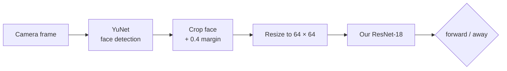

<div align="center">

# LookAway Guard

**Screen privacy through head orientation**

A laptop camera watches the person at the screen. When they look at the screen, it stays visible. When they look away, it would be blurred so nobody else can read it.


*University project for DMET 901 Computer Vision, German University in Cairo (GUC)*

</div>

---

## Overview

The core is a **ResNet-18** that classifies a 64 × 64 face crop as one of two classes:

| Class | Rule |
|---|---|
| **forward** | \|yaw\| ≤ 20° **and** \|pitch\| ≤ 20° |
| **away** | anything else |

It is trained on the **BIWI Kinect Head Pose** dataset with a **person-level split**: 12 people for training, 4 for validation and 4 for testing. The test people never appear in training, so the scores show how well the model works on new faces.



## Results

Test set (4 unseen people, 2,029 images), mean ± std over 3 seeds:

| Model | Macro-F1 | Accuracy | Real errors\* |
|---|---|---|---|
| Milestone 2 baseline | 0.894 ± 0.021 | 89.7% | 99 ± 34 |
| **Milestone 3: small-input ResNet-18 + 300W-LP training data** | **0.908 ± 0.005** | **91.0%** | **76 ± 6** |

\* Errors on heads that are clearly forward (< 17.5°) or clearly away (> 22.5°). Errors between 17.5° and 22.5°, right at the 20° line, are counted separately as "accepted".

### Milestone 3 improvements

Every experiment changes the model or the training data. The training settings, the loss and the metrics stay the same as in Milestone 2.

| Experiment | What changes | Test macro-F1 | Kept? |
|---|---|---|---|
| Baseline (MS2) | ResNet-18 on the crop enlarged to 224 × 224 | 0.894 ± 0.021 | |
| **A: Small input** | First conv uses stride 1 and the max-pool is removed, so the network reads the 64 × 64 crop directly | 0.889 ± 0.011 | ✅ |
| **B: + 300W-LP** | Adds the 300W-LP face crops (thousands of people) to training. Validation and test stay on the same BIWI people | 0.888 ± 0.013 | ✅ |
| **C: SE attention** | Adds a squeeze-and-excitation block to each residual block | 0.887 ± 0.015 | ❌ |
| **A + B** | Both together: **final model** | **0.908 ± 0.005** | ✅ |
| A + B + C | All three | 0.899 ± 0.005 | ❌ |

## Repository layout

```
.
├── MS1/                               Milestone 1: problem and dataset
├── MS2/                               Milestone 2: baseline ResNet-18
├── MS3/                               Milestone 3: improvements and the final model
│   ├── ms3_improvements.ipynb         the whole pipeline, from data download to the exported model
│   ├── ms3_results.json               saved metrics of every experiment
│   ├── figures/                       plots made by the notebook
│   ├── screenshots/                   notebook screenshots used in the presentation
│   └── make_slides.py                 builds MS3_presentation_proposal.pptx
├── desktop_app/                       LookAway Guard: the Electron app with the live camera
│   ├── main.js / preload.js / renderer.js / pipeline.js
│   └── models/                        YuNet + our ResNet-18 (ONNX)
├── MS3_presentation_proposal.pptx     proposed Milestone 3 slides (edit freely)
└── requirements.txt
```

## Run the Milestone 3 notebook

`MS3/ms3_improvements.ipynb` does everything from scratch, in order:

1. downloads BIWI and 300W-LP (about 1.4 GB) and the corrected BIWI angles,
2. labels and splits the data (12 / 4 / 4 people),
3. builds the six models (baseline, A, B, C, A + B, A + B + C),
4. trains each one with 3 seeds and prints the training log,
5. shows the results, the confusion matrices and where the errors are,
6. exports the final model to `desktop_app/models/` and checks it gives the same predictions.

Locally (a GPU is strongly recommended: all 18 runs take about 1.5 hours on an RTX 4070 laptop GPU, roughly 3–4 hours on a Colab T4):

```bash
python -m venv .venv
# Windows: .venv\Scripts\activate    macOS/Linux: source .venv/bin/activate
pip install -r requirements.txt       # for a CUDA GPU, install torch from https://pytorch.org first
jupyter notebook MS3/ms3_improvements.ipynb
```

Then click *Run all*. It also works in [Google Colab](https://colab.research.google.com) with a T4 GPU (*Runtime → Change runtime type*), but the saved runs are lost if the Colab session disconnects.

Finished runs are saved in `MS3/ms3_runs.json` and trained weights in `MS3/checkpoints/` (neither is in the repo). If the notebook stops, run it again and it continues where it stopped.

## Run the desktop app

Needs [Node.js](https://nodejs.org) 20 or newer. Works on Windows, Linux and macOS on Apple Silicon. The trained model is already included, so you do not need to run the notebook first.

```bash
cd desktop_app
npm install
npm start
```

| Key | Action |
|---|---|
| **Enter** (or the *Capture* button) | Analyse one photo |
| **L** | Toggle live mode |

How a camera frame becomes a prediction (`desktop_app/pipeline.js`):

1. **YuNet** (OpenCV Zoo, pretrained) finds the face.
2. The face is cropped the same way as the BIWI training crops (0.4 margin) and resized to 64 × 64.
3. **Our ResNet-18** (`desktop_app/models/head_direction_resnet18.onnx`) says forward or away.

## Data and credits

- **BIWI Kinect Head Pose**: Fanelli et al., 2013. We use the face crops prepared by [FSA-Net](https://github.com/shamangary/FSA-Net) and the corrected angles from [HeadPose+](https://github.com/kuhnkeF/headposeplus).
- **300W-LP**: Zhu et al., 2016. Face crops prepared by FSA-Net.
- **YuNet** face detector from the [OpenCV Model Zoo](https://github.com/opencv/opencv_zoo).

The datasets are not included in this repository. The notebooks download them.

## License

The code is released under the [MIT License](LICENSE). The datasets and the YuNet model keep their own licenses.
